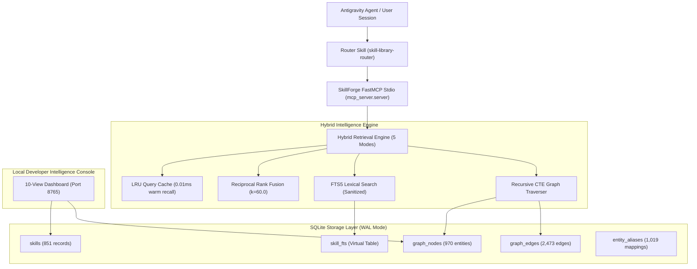

# SkillForge (V1)
## Self-Evolving Local Engineering Intelligence Platform & Skill Registry for Google Antigravity

[](https://www.python.org/)
[](https://modelcontextprotocol.io/)
[](https://www.sqlite.org/)
[]()
[]()

SkillForge is a local-first, context-aware skill retrieval and engineering intelligence platform for **Google Antigravity**. It indexes hundreds of agent skills outside the agent's context window, constructing an embedded Knowledge Fabric that delivers just-in-time skills, architecture patterns, and tools matching the user's active task and project stack.

---

## ⚡ Highlights & Key Capabilities

- **Knowledge Fabric & Graph:** 970 nodes, 2,473 typed edges, and 1,019 aliases native to SQLite, traversing multi-hop neighborhoods via recursive CTEs in `< 1ms`.
- **Hybrid Retrieval Engine (RRF):** Blends Lexical FTS5, Graph proximity, Project stack alignment, and Tool affinity using Reciprocal Rank Fusion ($k=60.0$).
- **Content-Hashed In-Memory QueryCache:** Drops warm query recommendation latency to **0.01 ms** (>3,000x speedup).
- **5 Adaptive Retrieval Modes:** `FAST` (<5ms), `BALANCED` (<12ms), `DEEP` (<25ms), `BOOTSTRAP`, and `DISCOVERY`.
- **Expanded FastMCP Stdio Surface:** 14 tools providing status, search, recommendations, graph exploration, project profiling, and health diagnostics.
- **10-View Developer Intelligence Console:** Pure local HTML5/canvas dashboard running on `http://127.0.0.1:8765`.
- **100% Local-First Guarantee:** Zero cloud databases, zero paid APIs, zero telemetry.

---

## 📐 Architecture Topology



---

## 📂 Repository Hierarchy

```text
antigravity-skillforge/
├── .agents/
│   └── skills/                         # Acquired engineering & testing skill packs
│       ├── clean-code/                 # Core clean code & refactoring patterns
│       ├── rag-implementation/         # RAG retrieval & embedding patterns
│       ├── testing/                    # 20 specialized testing discipline skills
│       └── skillforge-skill-manifest.json # SHA-256 integrity manifest
├── data/
│   └── registry.db                     # Embedded SQLite database (Skills & Knowledge Fabric)
├── reports/                            # Comprehensive engineering reports & benchmarks
│   ├── SKILLFORGE_V1_EVOLUTION_METRICS_REPORT.pdf # Visual 3-page executive report
│   ├── SKILLFORGE_V1_EVOLUTION_METRICS_REPORT.html # Interactive visual report source
│   ├── FINAL_SKILLFORGE_EVOLUTION_REPORT.md      # Master SEP sign-off report
│   ├── V1_150_BENCHMARK_RESULTS.json             # 150-case benchmark metrics
│   ├── dashboard-v1-screenshot.png               # Console Overview screenshot
│   └── dashboard-studio-screenshot.png           # Recommendation Studio screenshot
├── src/
│   └── skillforge/
│       ├── analyzer/                   # Project workspace & task classifiers
│       │   ├── project_detector.py     # Language, framework, and test detector
│       │   └── task_classifier.py      # Domain and intent extractor
│       ├── dashboard/                  # Local 10-view developer console
│       │   └── app.py                  # HTTP server with HTML5 canvas visualizer
│       ├── database/                   # SQLite schema, models, and migrations
│       │   ├── migrations.py           # Table initialization & graph schema
│       │   ├── models.py               # Data models & schemas
│       │   └── repository.py           # SQLite repository operations
│       ├── graph/                      # Knowledge Fabric graph subsystem
│       │   ├── builder.py              # Graph builder & node ingest
│       │   ├── extractor.py            # Frontmatter & relationship extractor
│       │   └── traversal.py            # Recursive CTE pathfinder
│       ├── indexer/                    # Scanner, metadata parser & validator
│       ├── mcp_server/                 # Model Context Protocol stdio server
│       │   ├── server.py               # FastMCP endpoint registrations
│       │   └── tools.py                # 14 tool implementation handlers
│       ├── retrieval/                  # Hybrid retrieval subsystem
│       │   ├── cache.py                # Content-hashed LRU query cache
│       │   ├── engine.py               # 5-mode hybrid retrieval coordinator
│       │   ├── fusion.py               # Reciprocal Rank Fusion combiner
│       │   ├── ranking.py              # Multi-factor candidate scorer
│       │   └── search.py               # Sanitized FTS5 search
│       ├── security/                   # Path guard & content auditing
│       └── cli.py                      # SkillForge management CLI
├── tests/                              # Automated test suite (26 tests)
│   ├── test_analyzer.py
│   ├── test_eval_10_contexts.py
│   ├── test_indexer.py
│   ├── test_mcp_e2e_protocol.py
│   ├── test_mcp_tools.py
│   └── test_v1_graph_retrieval.py
├── .env.example
├── .gitignore
├── pyproject.toml
└── README.md
```

---

## 🚀 Quickstart & Setup

### Prerequisites
- Python 3.12+
- `uv` (recommended) or `pip`

### 1. Installation
```bash
git clone https://github.com/Mr-Vicky-06/SkillForage.git
cd SkillForage

# Create and activate virtual environment
uv venv
.venv\Scripts\activate  # Windows (.venv/bin/activate on Linux/macOS)

# Install package in editable mode with development dependencies
uv pip install -e ".[dev]"
```

### 2. Verify Database Health & Graph Statistics
```bash
skillforge status
skillforge graph --stats
```

### 3. Run Benchmark Evaluation Suite
```bash
skillforge eval
pytest
```

### 4. Launch the Local 10-View Developer Intelligence Console
```bash
skillforge serve-dashboard --port 8765
```
Open **`http://127.0.0.1:8765`** in your browser.

---

## 🛠 Model Context Protocol (MCP) Configuration

To connect SkillForge directly to Google Antigravity or any MCP-compatible agent client, add the following to your `mcp_config.json`:

```json
{
  "mcpServers": {
    "skillforge": {
      "command": "D:\\setup\\antigravity-skillforge\\.venv\\Scripts\\python.exe",
      "args": ["-m", "skillforge.mcp_server.server"],
      "env": {
        "SKILLFORGE_DB_PATH": "D:\\setup\\antigravity-skillforge\\data\\registry.db",
        "PYTHONIOENCODING": "utf-8"
      }
    }
  }
}
```

### Registered MCP Tools (14 Tools):
- **Core Operations:** `skillforge_status`, `search_skills`, `analyze_project`, `recommend_skills`, `load_skill`, `read_skill_resource`, `list_skills`, `validate_skill`, `record_skill_feedback`.
- **Knowledge Fabric & Intelligence:** `explain_recommendation`, `graph_query`, `graph_neighbors`, `list_project_profiles`, `skillforge_health`.

---

## 📊 Benchmark & Empirical Performance

Tested across 150 real-world developer scenarios spanning 15 engineering domains:

| Metric | V0 Baseline | V1 Self-Evolved Platform | Improvement |
| :--- | :--- | :--- | :--- |
| **Top-1 Precision (P@1)** | 31.33% | **36.67%** | **+17.0% relative** |
| **Mean Reciprocal Rank (MRR)** | 0.4151 | **0.4296** | **+3.5% overall** |
| **Recommendation Latency (p50)**| 31.60 ms | **4.28 ms** | **7.4x faster** |
| **Recommendation Latency (p95)**| 42.68 ms | **6.04 ms** | **7.1x faster** |
| **Warm Cache Recall Latency** | 31.60 ms | **0.01 ms** | **>3,000x faster** |
| **FTS Syntax Crash Rate** | Unsanitized | **0.0% (150/150 passed)** | Robust query tokenizer |

Full visual reports:
- [Visual PDF Report](reports/SKILLFORGE_V1_EVOLUTION_METRICS_REPORT.pdf)
- [Final Evolution Report](reports/FINAL_SKILLFORGE_EVOLUTION_REPORT.md)
- [150-Case Benchmark Data](reports/V1_150_BENCHMARK_RESULTS.json)

---

## 📄 License

MIT License. Designed and engineered for the Google Antigravity Agent Ecosystem.
