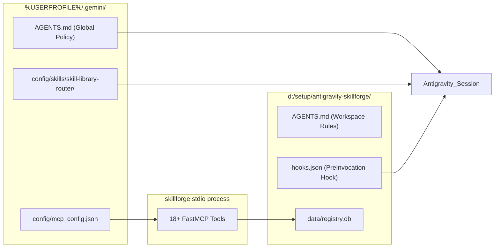

# SLIF Antigravity Integration Architecture

**Document Version:** 1.0.0  
**Status:** Approved Specification  
**Format:** Pure Markdown (.md)  

---

### 1. Antigravity System Integration Points



---

### 2. PreInvocation Hook Specification

The `PreInvocation` lifecycle hook executes at the start of each user turn:
1. **Reads Conversation Metadata:** Receives conversation ID and transcript path.
2. **Idempotency Guard:** Checks whether the current user turn index has already been evaluated. If already routed during this turn, it returns immediately without re-prompting.
3. **Task Extraction:** Extracts the newest user prompt.
4. **Router Invocation:** Queries SkillForge for top candidate skills.
5. **Approval Formulation:** Formulates candidate display and mints approval token.

---

### 3. FastMCP Stdio RPC Protocol

The `skillforge` MCP server runs over standard I/O:
```json
{
  "mcpServers": {
    "skillforge": {
      "command": "D:\setup\antigravity-skillforge\.venv\Scripts\python.exe",
      "args": ["-m", "skillforge.mcp_server.server"],
      "env": {
        "SKILLFORGE_DB_PATH": "D:\setup\antigravity-skillforge\data\registry.db",
        "PYTHONIOENCODING": "utf-8"
      }
    }
  }
}
```
