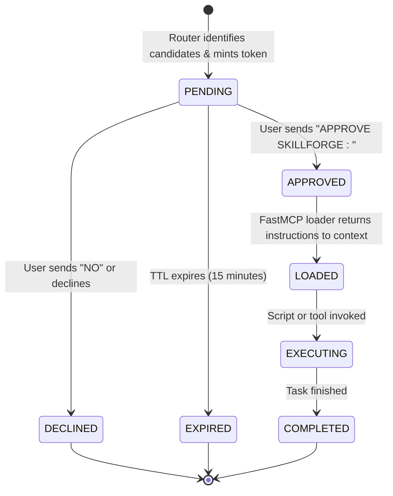

# SLIF Mandatory Human Approval & Authorization Architecture

**Document Version:** 1.0.0  
**Status:** Approved Specification  
**Format:** Pure Markdown (.md)  

---

### 1. The Core Authorization Doctrine

> [!IMPORTANT]
> **NO SPECIALIST SKILL INSTRUCTION OR SCRIPT MAY ENTER CONTEXT OR EXECUTE WITHOUT EXPLICIT CONVERSATIONAL HUMAN APPROVAL.**

Antigravity natively reads skills it discovers. To prevent unauthorized execution:
1. All specialist skills reside in the external vault (`vault/skills/`).
2. Only the lightweight Router exists in Antigravity's global skill directory.
3. The FastMCP loader requires a valid, unexpired approval record before releasing any `SKILL.md` body.

---

### 2. Approval Token State Machine



---

### 3. Conversational Consent Protocol

When Antigravity routes a task, it presents this exact dialogue to the user:

```text
SkillForge has analyzed your task: "Tune XGBoost hyper-parameters and validate data pipeline"

Recommended skills:
1. data-autocleaning (P0) — Automated data quality, schema mapping, and preprocessing.
2. python-performance-optimization (P1) — Vectorization, caching, and algorithmic efficiency.
3. cross-source-verification (P0) — Statistical verification and metric cross-checking.

To activate, please reply with one of:
- "APPROVE SKILLFORGE A1B2C3" — activate all recommendations
- "APPROVE SKILLFORGE A1B2C3: data-autocleaning" — activate selected skill(s)
- "NO" — proceed without specialist skills

[Token: A1B2C3 | TTL: 15m | Session: 8f2c-9a10]
```

#### Verification Rules:
- The loader rejects calls if the token is not found or has status other than `APPROVED`.
- The loader rejects skill IDs that were not in the candidate list minted with that token.
- Tokens are single-use: once loaded, status transitions to `LOADED`.
- Additional skills discovered during execution require a fresh candidate list and fresh approval token.
