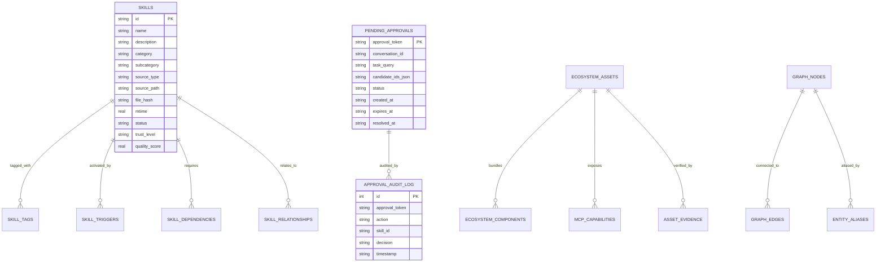

# SLIF Database Schema & Relational Model Specification

**Document Version:** 1.0.0  
**Status:** Approved Specification  
**Database Engine:** SQLite 3 (WAL Mode, Normal Synchronous, Foreign Keys ON)  
**Location:** `data/registry.db`  

---

### 1. Complete Relational Table Matrix



---

### 2. DDL Schema Definition (Key Additions)

```sql
-- SLIF Approval State & Session Tracking
CREATE TABLE IF NOT EXISTS pending_approvals (
    approval_token TEXT PRIMARY KEY,
    conversation_id TEXT,
    turn_id INTEGER DEFAULT 1,
    task_query TEXT NOT NULL,
    candidate_ids_json TEXT NOT NULL,
    status TEXT NOT NULL DEFAULT 'pending', -- pending, approved, declined, expired, loaded
    created_at TEXT NOT NULL,
    expires_at TEXT NOT NULL,
    resolved_at TEXT
);

CREATE TABLE IF NOT EXISTS approval_audit_log (
    id INTEGER PRIMARY KEY AUTOINCREMENT,
    approval_token TEXT NOT NULL,
    conversation_id TEXT,
    action TEXT NOT NULL, -- recommend, approve, decline, load, execute
    skill_id TEXT,
    decision TEXT NOT NULL,
    details_json TEXT,
    timestamp TEXT NOT NULL
);

CREATE INDEX IF NOT EXISTS idx_approvals_status ON pending_approvals(status);
CREATE INDEX IF NOT EXISTS idx_approvals_expires ON pending_approvals(expires_at);
CREATE INDEX IF NOT EXISTS idx_approval_audit_token ON approval_audit_log(approval_token);
```
