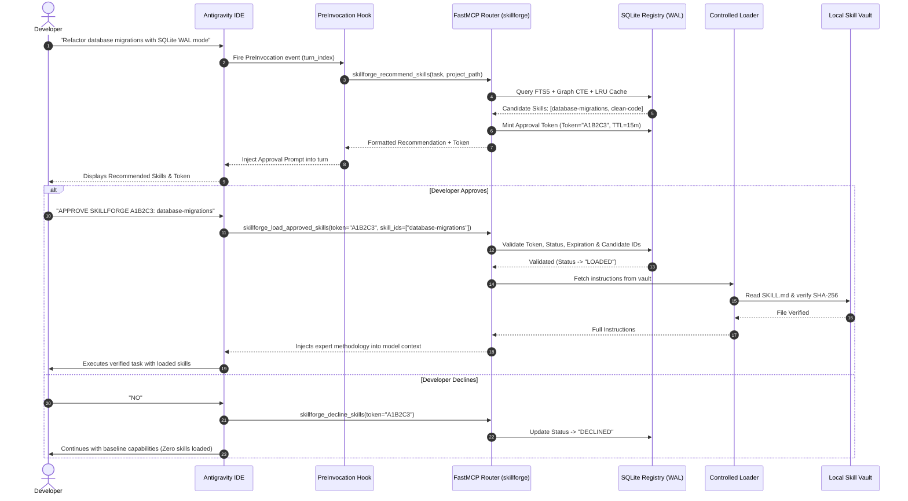
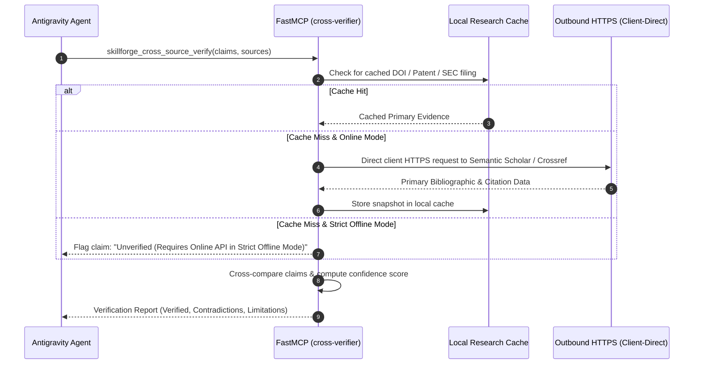

# SLIF End-to-End Data Flow Diagrams

**Document Version:** 1.0.0  
**Status:** Approved Specification  
**Format:** Pure Markdown (.md)  

---

### 1. Task Ingestion, Routing, Approval & Execution Flow

---

### 2. Cross-Source Research Verification Data Flow

