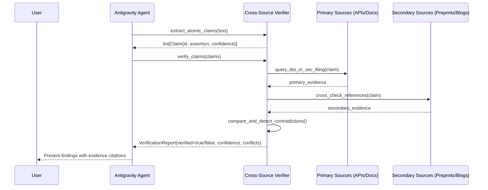

# SLIF Research Intelligence & Cross-Source Verification Architecture

**Document Version:** 1.0.0  
**Status:** Approved Specification  
**Format:** Pure Markdown (.md)  

---

### 1. The 25 Research Skills Inventory

```text
+-------------------------------------------------------------------------------+
|                       THE 25 RESEARCH INTELLIGENCE SKILLS                     |
+--------------------------+------------------------------+---------------------+
| DOMAIN 1: SCHOLARLY      | DOMAIN 2: ARCHITECTURE       | DOMAIN 3: MARKET    |
| - semantic-scholar...    | - technology-comparison...   | - competitive-...   |
| - systematic-lit-prisma  | - architecture-spike...      | - sec-edgar-...     |
| - crossref-doi-...       | - rfc-adr-writing            | - saas-pricing-...  |
| - latex-paper-authoring  | - api-reverse-eng-har        | - industry-trend-...|
+--------------------------+------------------------------+---------------------+
| DOMAIN 4: PATENTS & IP   | DOMAIN 5: OPEN-SOURCE        | DOMAIN 6: EMPIRICAL |
| - patent-prior-art...    | - github-ecosystem...        | - ab-testing-...    |
| - patent-claims...       | - oss-license-audit          | - fact-checking-... |
| - freedom-to-operate     | - package-supply-chain...    | - eda-analysis      |
| - trademark-clearance    | - lib-rs-crates-benchmark    | - whitepaper-...    |
+--------------------------+------------------------------+---------------------+
| CORE CROSS-CUTTING:      | cross-source-verification    | (Continuous Gate)   |
+--------------------------+------------------------------+---------------------+
```

---

### 2. Cross-Source Verification Engine Protocol



#### 10 Verification Standards:
1. Extract atomic factual claims.
2. Identify claims requiring empirical evidence.
3. Prioritize primary sources (official SEC 10-K, IEEE/ACM DOIs, git commits).
4. Resolve bibliographic metadata and verify author/date.
5. Check citation context to prevent quote truncation.
6. Compare multiple independent sources.
7. Explicitly flag source contradictions.
8. Distinguish verified facts from statistical inference.
9. Record exact access timestamps and snapshot hashes.
10. Report confidence intervals and evidence limitations.
