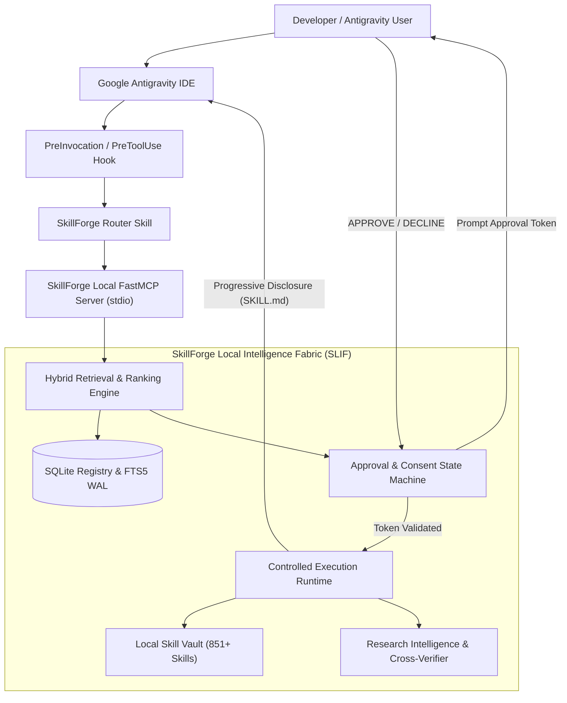

# SkillForge Local Intelligence Fabric (SLIF) - Master System Architecture

**Document Version:** 1.0.0  
**Status:** Approved Specification  
**Architecture Date:** 2026-11-03  
**Target Environment:** Local Windows 11 x64, Google Antigravity IDE (v2.6.0), FastMCP Stdio  

---

### 1. Architectural Vision

SkillForge Local Intelligence Fabric (SLIF) is a production-grade, 100% locally operated skill intelligence platform for Google Antigravity. It manages hundreds or thousands of specialist agent skills outside Antigravity's active context window, providing just-in-time recommendation, strict conversational human approval, controlled loading, local script execution, and continuous cross-source verification without any external servers or hosted backends.

---

### 2. The 7 Architectural Layers

| Layer | Component Name | Primary Responsibility | Local Storage / Technology |
|---|---|---|---|
| **Layer 1** | **Antigravity Integration** | Hooks, Global Rules, FastMCP Stdio RPC, Transcript extraction | `.agents/`, `~/.gemini/`, FastMCP stdio |
| **Layer 2** | **Skill Router** | Intent detection, task decomposition, multi-domain routing | `src/skillforge/retrieval/engine.py` |
| **Layer 3** | **Human Approval Gate** | Single-use token generation, state validation, expiration | SQLite `pending_approvals`, cryptographic tokens |
| **Layer 4** | **Local Skill Vault** | Immutable skill packages, dependencies, scripts, references | `vault/skills/` (categorized filesystem) |
| **Layer 5** | **Controlled Loader** | Progressive disclosure loader, checksum & manifest audit | `src/skillforge/runtime/loader.py` |
| **Layer 6** | **Research Intelligence** | 25 specialized research skills, cross-source fact checking | `vault/skills/research/`, direct outbound APIs |
| **Layer 7** | **Security & Audit** | Static AST inspection, least-privilege policies, audit log | `data/audit.log`, SHA-256 checksum registry |

---

### 3. Local-First Guarantee

- **Zero Hosted Backend:** No cloud database, no VPS, no web daemon, no telemetry.
- **Direct Client Egress:** When research skills query public APIs (Semantic Scholar, SEC EDGAR, Crossref, GitHub), requests originate directly from the developer machine via local Python HTTPS client.
- **Strict-Offline Mode:** An environment variable `SKILLFORGE_OFFLINE_MODE=1` disables all outbound HTTP requests and falls back entirely to local documentation, cached snapshots, and local AST parsing.
