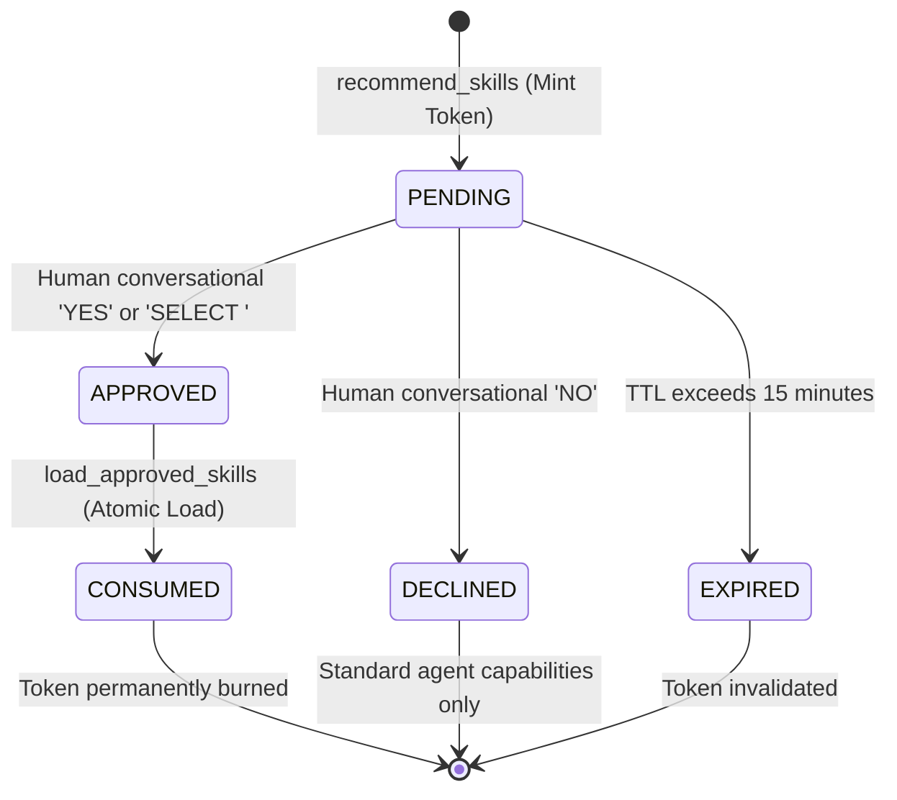

# SkillForge Local Intelligence Fabric (SLIF)
# Human Approval Gate & Authorization Lifecycle Validation Report

**Document Date:** November 3, 2026  
**Component:** `skillforge.approval.token_manager.ApprovalTokenManager`  
**Architecture:** Zero-Trust Human-in-the-Loop (HITL) Context Authorization  
**Verification Target:** SLIF P0 Security Hardening Sprint  

---

## 1. Architectural Philosophy: The Strict Human Gate

In enterprise agentic workflows, an autonomous agent must never be permitted to unilaterally load specialized executable instructions, execute arbitrary scripts, or alter its own core behavioral directives without explicit, verifiable human consent. 

The SkillForge Local Intelligence Fabric enforces this requirement via an asynchronous, single-use, cryptographically generated token lifecycle.



---

## 2. State Machine Specification & Invariant Rules

### 2.1. State Definition
1. **`PENDING`**: Initial minted state. The user has been presented with candidate skills and the reasons for their recommendation. **Loading and execution are strictly prohibited.**
2. **`APPROVED`**: Active authorization state. The user has provided an explicit conversational approval action (`YES` or `SELECT <id>`). The token records the exact list of approved skill IDs (`approved_ids_json`).
3. **`CONSUMED`**: Terminal utilized state. The skill instructions have been read into the active LLM context. **The token is permanently consumed and cannot be reused.**
4. **`DECLINED`**: Terminal rejection state. The human rejected the specialist skills (`NO`). The workflow proceeds with general baseline intelligence.
5. **`EXPIRED`**: Terminal invalid state. The token's time-to-live (default: 15 minutes) was exceeded prior to human approval.

### 2.2. Invariant Security Rules
- **Rule AG-01 (Prerequisite State):** An approval request must be in `PENDING` state to transition to `APPROVED` or `DECLINED`.
- **Rule AG-02 (Prerequisite Load):** A token must be in `APPROVED` state to be accepted by `ControlledSkillLoader` or `LocalSkillExecutor`. Any attempt to load with a `PENDING` token fails with `ACCESS DENIED`.
- **Rule AG-03 (Single-Use Replay Prevention):** Once `consume_token` executes, the state immediately transitions to `CONSUMED`. Subsequent calls using the same token fail with `ACCESS DENIED: Token has already been consumed (replay prevention)`.
- **Rule AG-04 (No Empty-Selection Fallback):** Calling `approve_token` with an empty skill list (`approved_skill_ids=[]`) fails immediately. It will **never** silently fall back to approving all candidate skills.
- **Rule AG-05 (Subset Containment):** Every approved skill ID must be a member of the original candidate set proposed during recommendation. Any attempt to inject an unproposed skill returns `ACCESS DENIED`.
- **Rule AG-06 (Mandatory Conversation Binding):** If a token was minted with a specific `conversation_id`, all approval and consumption calls must supply that identical `conversation_id`. Mismatched or empty conversation IDs fail with `Conversation binding mismatch`.

---

## 3. Cryptographic Token Generation & Storage

### 3.1. Token Entropy
Tokens are formatted as `SF-<32_HEX_CHARS>`.
- Generated using `secrets.token_hex(16).upper()`.
- Provides $16 \times 8 = 128$ bits of cryptographic entropy.
- Immune to brute-force enumeration, collision, or sequential prediction attacks.

### 3.2. SQLite Schema (`pending_approvals`)
```sql
CREATE TABLE IF NOT EXISTS pending_approvals (
    approval_token TEXT PRIMARY KEY,
    task_hash TEXT NOT NULL,
    task_description TEXT NOT NULL,
    candidate_ids_json TEXT NOT NULL,
    approved_ids_json TEXT,
    conversation_id TEXT,
    status TEXT NOT NULL DEFAULT 'pending',
    created_at TEXT NOT NULL,
    expires_at TEXT NOT NULL,
    approved_at TEXT,
    consumed_at TEXT,
    turn_id INTEGER DEFAULT 1
);
```

---

## 4. Adversarial Attack Vector Validation

The hardened approval gate was subjected to exhaustive penetration tests across seven targeted attack scenarios:

### Test Case 1: Unapproved Loading Attempt (`test_adv_01_loading_with_pending_token`)
- **Attack Scenario:** An agent attempts to immediately load skill instructions using a freshly generated `PENDING` token before waiting for the user's conversational turn.
- **Result:** `PASS`. `ControlledSkillLoader` rejected the request with:  
  `ACCESS DENIED: Token 'SF-...' is in PENDING state. Explicit user conversational approval is required before loading.`

### Test Case 2: Token Replay Attack (`test_adv_02_loading_with_consumed_token`)
- **Attack Scenario:** An agent attempts to reuse a token that was already used to load a skill in a previous turn to secretly load another skill.
- **Result:** `PASS`. The second invocation was rejected with:  
  `ACCESS DENIED: Token 'SF-...' has already been consumed (replay prevention). Request a fresh recommendation.`

### Test Case 3: Unauthorized Skill Injection (`test_adv_03_reusing_token_unapproved_skill`)
- **Attack Scenario:** The user approves only `skill_a`. The agent attempts to use that token to load `skill_b`.
- **Result:** `PASS`. The loader rejected `skill_b` with:  
  `ACCESS DENIED: Skill 'skill_b' was not approved under token 'SF-...'.`

### Test Case 4: Unbound Conversation Hijacking (`test_adv_04_missing_conversation_id_when_bound`)
- **Attack Scenario:** A malicious client attempts to approve a token that was bound to a specific user conversation by omitting the conversation identifier.
- **Result:** `PASS`. The approval manager rejected the request with:  
  `ACCESS DENIED: Conversation binding mismatch. Token is bound to conversation 'conv-sec-bound-100'.`

### Test Case 5: Conversation Spoofing Attack (`test_adv_05_wrong_conversation_id_spoofing`)
- **Attack Scenario:** An attacker in session `conv-attacker` attempts to approve a token belonging to `conv-legit-user`.
- **Result:** `PASS`. Rejected with:  
  `ACCESS DENIED: Conversation binding mismatch. Token is bound to conversation 'conv-legit-user'.`

### Test Case 6: Empty Selection Trick (`test_adv_06_empty_skill_selection`)
- **Attack Scenario:** A caller passes `approved_skill_ids=[]` hoping the system will fall back to approving all candidate skills.
- **Result:** `PASS`. The manager rejected the call with:  
  `ACCESS DENIED: No skills selected for approval. Explicit selection is mandatory.`

### Test Case 7: Direct Unapproved MCP Call (`test_adv_07_unauthorized_legacy_loader_calls`)
- **Attack Scenario:** An external MCP caller directly invokes `load_skill("karpathy-guidelines")` without passing any authorization token.
- **Result:** `PASS`. The MCP tool returned:  
  `ACCESS DENIED: load_skill requires an active approval token. Specialist skills cannot be loaded without explicit user consent.`

---

## 5. Conclusion & Verification Verdict

The SkillForge Approval Gate is cryptographically sound, state-enforced, and strictly bound to user intent. It guarantees that no specialist skill can be activated into context without unambiguous human authorization.
