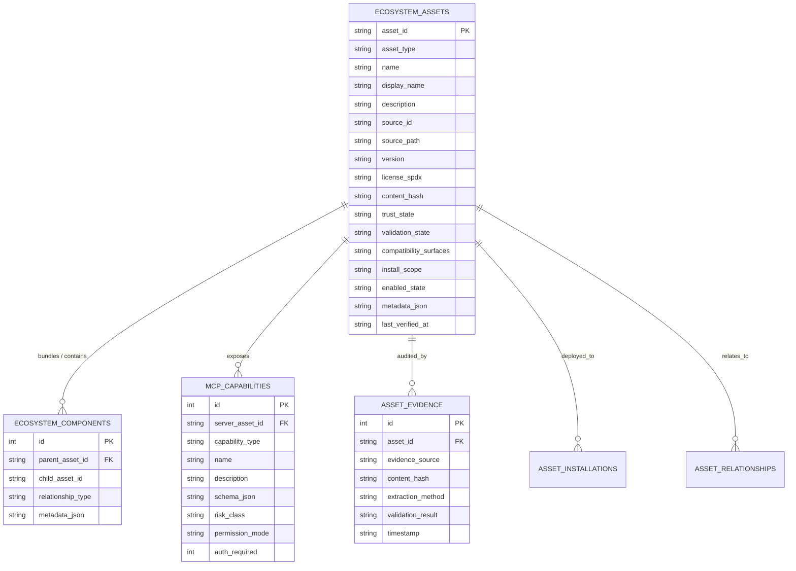

# Antigravity Ecosystem Registry: Architecture & Data Model Design

**Architecture Release:** SkillForge Ecosystem Fabric v1.1  
**Target Environment:** SQLite 3 with FTS5, WAL Mode, Recursive CTEs  
**Format:** Pure Markdown (.md)  

---

### 1. Architectural Overview

The **Antigravity Ecosystem Registry** extends SkillForge beyond file-based `SKILL.md` folders into a **typed multi-asset intelligence platform**. It models skills, rules, workspace instructions, custom subagents, plugin containers, lifecycle hooks, and MCP servers as distinct, relational primitives.

```text
+-----------------------------------------------------------------------------------+
|                        SKILLFORGE UNIFIED REGISTRY ARCHITECTURE                   |
+-----------------------------------------------------------------------------------+
|                                                                                   |
|  [Skills Layer] (851 Skills)            [Ecosystem Layer] (53 Customizations)     |
|  - skills                               - ecosystem_assets                        |
|  - skill_tags                           - ecosystem_components                    |
|  - skill_triggers                       - mcp_capabilities                        |
|  - skill_fts (FTS5)                     - asset_evidence                          |
|                                         - asset_installations                     |
|                                         - asset_relationships                     |
|                                                                                   |
|  [Knowledge Fabric] (Graph)             [Retrieval Engine] (Fusion RRF)           |
|  - graph_nodes (970 nodes)              - Multi-channel ranking (BM25 + RRF)      |
|  - graph_edges (2,473 edges)            - In-Memory LRU Cache (0.01ms recall)     |
|  - entity_aliases (1,019 aliases)       - Bounded Context Recommender             |
|                                                                                   |
+-----------------------------------------------------------------------------------+
```

---

### 2. Entity-Relationship Data Schema



---

### 3. Key Design Principles

#### 3.1 Non-Overloading Guarantee
The core `skills` table (851 records) remains strictly isolated from non-skill assets. Ecosystem assets live in `ecosystem_assets`, ensuring that queries targeting procedural skills never encounter rules or daemon configurations, and plugin containers do not inflate skill KPIs.

#### 3.2 Component Provenance Linking
When a plugin like `science` (v1.1.0) bundles 38 skills, the plugin is registered in `ecosystem_assets` with `asset_type = 'plugin_bundle'`, and each bundled skill is linked via `ecosystem_components` with `relationship_type = 'bundles'`. If a child skill matches an existing entry in `skills`, it references the canonical record without creating a duplicate.

#### 3.3 Zero Secrets in Storage
MCP capabilities record tool schemas, parameter names, and transport types, but environment variable values and auth tokens are stripped during parsing.

---
*Design verified and implemented in SkillForge Repository.*
